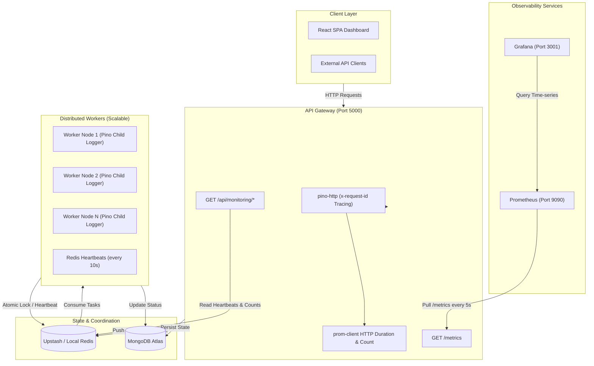

# DevOps, Observability, Logging & Testing Guide

Engineering reference for the **Distributed Job Processing Platform** — covering the observability stack, structured logging, automated test suites, load testing, containerization, and operational runbooks.

---

## 📑 Table of Contents

1. [Architecture Overview](#1-architecture-overview)
2. [Monitoring & Observability](#2-monitoring--observability)
3. [Structured Logging & Request Tracing](#3-structured-logging--request-tracing)
4. [Automated Testing — Vitest](#4-automated-testing--vitest)
5. [Load & Performance Testing — k6](#5-load--performance-testing--k6)
6. [Containerization & Orchestration](#6-containerization--orchestration)
7. [Operational Runbook](#7-operational-runbook)

---

## 1. Architecture Overview



---

## 2. Monitoring & Observability

### Prometheus Metrics

The backend exposes `GET /metrics` via [`prom-client`](https://github.com/siimon/prom-client) ([`src/utils/metrics.js`](file:///d:/Backend/Backend%20Projects/Distributed%20Job%20Processing%20Platform/backend/src/utils/metrics.js)).

#### System & Runtime
Auto-collected with prefix `job_platform_`:

| Metric | Description |
|---|---|
| `job_platform_process_cpu_user_seconds_total` | CPU user time |
| `job_platform_nodejs_heap_size_used_bytes` | Heap used |
| `job_platform_process_resident_memory_bytes` | RSS memory |
| `job_platform_nodejs_eventloop_lag_seconds` | Event loop lag |

#### HTTP (RED Method)

| Metric | Type | Labels | Description |
|---|---|---|---|
| `http_request_duration_seconds` | Histogram | `method`, `route`, `status_code` | Latency buckets: `[0.05, 0.1, 0.25, 0.5, 1, 2.5, 5]`s |
| `http_request_total` | Counter | `method`, `route`, `status_code` | Cumulative request count |

#### Queue & Worker State

| Metric | Type | Labels | Description |
|---|---|---|---|
| `bullmq_queue_jobs_count` | Gauge | `queue`, `state` | Live counts per BullMQ state (`waiting`, `active`, `delayed`, `failed`, `completed`) |
| `job_platform_active_workers_count` | Gauge | — | Live worker instances broadcasting heartbeats |
| `job_execution_duration_seconds` | Histogram | `job_type`, `status` | Worker execution duration buckets: `[0.1, 0.5, 1, 2, 5, 10, 15]`s |
| `jobs_processed_total` | Counter | `job_type`, `status` | Total processed jobs by outcome |

---

### Prometheus Configuration

Config: [`monitoring/prometheus/prometheus.yml`](file:///d:/Backend/Backend%20Projects/Distributed%20Job%20Processing%20Platform/monitoring/prometheus/prometheus.yml)

```yaml
global:
  scrape_interval: 5s
  evaluation_interval: 5s

scrape_configs:
  - job_name: "job-platform-api"
    metrics_path: "/metrics"
    static_configs:
      - targets: ["api:5000"]
        labels:
          service: "backend-api"
          environment: "production"
```

> Access Prometheus UI at `http://localhost:9090`

---

### Grafana Dashboards

**Zero manual setup.** Datasources and dashboards are fully provisioned via code on startup.

| File | Purpose |
|---|---|
| [`provisioning/datasources/datasource.yml`](file:///d:/Backend/Backend%20Projects/Distributed%20Job%20Processing%20Platform/monitoring/grafana/provisioning/datasources/datasource.yml) | Points to `http://prometheus:9090` |
| [`provisioning/dashboards/dashboards.yml`](file:///d:/Backend/Backend%20Projects/Distributed Job Processing Platform/monitoring/grafana/provisioning/dashboards/dashboards.yml) | Watches `/var/lib/grafana/dashboards`, reloads every 10s |
| [`dashboards/job_platform_dashboard.json`](file:///d:/Backend/Backend%20Projects/Distributed%20Job%20Processing%20Platform/monitoring/grafana/dashboards/job_platform_dashboard.json) | Pre-built dashboard |

Access at `http://localhost:3001` · Credentials: `admin` / `admin`

**Dashboard Panels:**

| Row | Panels |
|---|---|
| **Row 1 — Status Overview** | Active Worker Nodes · Waiting Backlog · Active Processing · Failed in Queue |
| **Row 2 — Queue & Throughput** | Queue State Breakdown (time-series) · Job Throughput Rate (jobs/sec) |
| **Row 3 — Latency & API Health** | Job Execution Latency P95 vs P50 · HTTP Request Rate by Status Code |
| **Row 4 — Process Health** | Node.js Memory Footprint (Heap Used / Heap Total / RSS) |

---

### Native Monitoring Endpoints

All endpoints require JWT authentication except `/health`.

| Endpoint | Description |
|---|---|
| `GET /api/monitoring/overview` | Full cluster summary — queue, jobs, workers |
| `GET /api/monitoring/queue` | BullMQ live counts |
| `GET /api/monitoring/workers` | Active worker heartbeats (Redis SCAN) |
| `GET /api/monitoring/jobs` | Historical job stats & performance |
| `GET /health` | Unauthenticated liveness probe → `{ status: "OK", timestamp }` |
| `GET /metrics` | Prometheus scrape endpoint |

---

## 3. Structured Logging & Request Tracing

The platform uses [**Pino**](https://getpino.io/) ([`src/utils/logger.js`](file:///d:/Backend/Backend%20Projects/Distributed%20Job%20Processing%20Platform/backend/src/utils/logger.js)) — a non-blocking, asynchronous JSON logger with near-zero event loop overhead.

### Log Formats

**Development** — colorized, human-readable via `pino-pretty`:
```text
[2026-10-27 23:33:44.236] INFO: POST /api/auth/refresh 200
    service: "job-processing-platform"
    req: { "id": "075db101-...", "method": "POST", "url": "/api/auth/refresh" }
    responseTime: 4
```

**Production** — single-line JSON for log aggregators (Datadog, Loki, CloudWatch):
```json
{"level":30,"time":"2026-10-27T18:03:44.236Z","service":"job-processing-platform","req":{"id":"075db101-...","method":"POST","url":"/api/auth/refresh"},"res":{"statusCode":200},"responseTime":4,"msg":"POST /api/auth/refresh 200"}
```

---

### PII & Secret Redaction

Pino automatically strips sensitive fields before writing to stdout ([`src/utils/logger.js`](file:///d:/Backend/Backend%20Projects/Distributed%20Job%20Processing%20Platform/backend/src/utils/logger.js)):

```javascript
redact: {
  paths: [
    "req.headers.authorization",
    "req.headers.cookie",
    "password",
    "token",
    "brevoApiKey",
  ],
  remove: true,
}
```

---

### Request Tracing (x-request-id)

[`src/middleware/httpLogger.js`](file:///d:/Backend/Backend%20Projects/Distributed%20Job%20Processing%20Platform/backend/src/middleware/httpLogger.js) uses `pino-http` to propagate trace context:

- Reads `x-request-id` from incoming headers (Vercel / Cloudflare / API Gateway); generates a UUID if absent.
- Log level mapping: `5xx` → `error` · `4xx` → `warn` · `2xx/3xx` → `info`

### Worker Contextual Logging

Each job runs inside a scoped child logger ([`src/worker/jobWorker.js`](file:///d:/Backend/Backend%20Projects/Distributed%20Job%20Processing%20Platform/backend/src/worker/jobWorker.js)):

```javascript
const jobLog = logger.child({ workerId, jobId, type });
jobLog.info("Starting processing for job");
```

Filter logs by `jobId` or `workerId` to instantly trace the full lifecycle of any job across scaled replicas.

---

## 4. Automated Testing — Vitest

**Framework**: [Vitest](https://vitest.dev/) + [Supertest](https://github.com/ladjs/supertest)  
**Config**: [`backend/vitest.config.mjs`](file:///d:/Backend/Backend%20Projects/Distributed%20Job%20Processing%20Platform/backend/vitest.config.mjs)

- Runs in isolated worker threads — one per file, no shared state.
- `clearMocks: true` — mocks reset automatically between tests.
- No live cloud dependencies — all Redis/MongoDB calls are mocked.
- Load tests excluded via `exclude: ["**/tests/load/**"]`.

### Run Commands

```bash
# Run all 100 tests
npm --prefix backend test

# Watch mode
npm --prefix backend run test:watch
```

```text
 Test Files  17 passed (17)
      Tests  100 passed (100)
   Duration  ~5s
```

---

### Unit Tests — `backend/tests/unit/`

| Layer | File | Tests | Coverage |
|---|---|---|---|
| `middleware/` | `auth.test.js` | 6 | JWT in header/cookie, missing token 401, expired 401, invalid signature 403 |
| `middleware/` | `rateLimiter.test.js` | 3 | Below-limit pass, `X-RateLimit-*` headers, 429 on quota exhaustion |
| `middleware/` | `idempotency.test.js` | 5 | Header absent skip, cache-on-first, replay returns cached, concurrent duplicate block |
| `middleware/` | `backpressure.test.js` | 3 | Pass when below threshold, 503 when queue overloaded |
| `middleware/` | `validateRequest.test.js` | 6 | Zod validation on body/query/params, 400 with structured errors |
| `services/` | `jobService.test.js` | 9 | Create, enqueue, priority mapping, `PENDING→CANCELLED`, pagination, status filter |
| `services/` | `dlqService.test.js` | 5 | Fetch dead jobs, replay to BullMQ, reset attempt counter |
| `services/` | `monitoringService.test.js` | 3 | Metric aggregation, queue counts, heartbeat parsing |
| `processors/` | `email.processor.test.js` | 8 | Brevo dispatch, transient retry backoff, fatal validation → DEAD, simulation mode |
| `utils/` | `jwt.test.js` | 4 | Access/refresh token generation & verification, custom claims |
| `utils/` | `lock.test.js` | 6 | `SET NX EX` acquire, collision handling, TTL expiry, safe release by token |
| `utils/` | `timeout.test.js` | 4 | Completes within deadline, timeout rejection, AbortSignal, boundary edge case |

---

### Integration Tests — `backend/tests/integration/`

Full HTTP round-trip tests via Supertest against the Express app.

| File | Tests | Routes & Flows |
|---|---|---|
| `auth.routes.test.js` | 12 | Register, duplicate rejection, login + cookie issuance, token refresh rotation, logout, `/api/auth/me` |
| `job.routes.test.js` | 11 | Submit job 202, schema validation 400, idempotency replay, paginated list, get by ID, cancel PENDING, cancel non-PENDING 400, 404s |
| `dlq.routes.test.js` | 7 | List dead jobs, successful retry + re-enqueue, concurrent lock conflict 400, not-found 404, wrong-state retry 400 |
| `monitoring.routes.test.js` | 5 | Auth guard 401, queue stats, job aggregation, worker heartbeats, full overview |
| `health.routes.test.js` | 3 | `GET /health` 200, unknown route 404, Helmet security headers |

---

## 5. Load & Performance Testing — k6

Performance and stress tests using [**k6**](https://k6.io/), located in [`backend/tests/load/`](file:///d:/Backend/Backend%20Projects/Distributed%20Job%20Processing%20Platform/backend/tests/load).

> [!NOTE]
> k6 tests are excluded from the Vitest runner. They require a running backend server and the `k6` binary installed separately.

### Test Scenarios

| Script | Target | VUs / Pattern | Key Assertion |
|---|---|---|---|
| [`smoke.js`](file:///d:/Backend/Backend%20Projects/Distributed%20Job%20Processing%20Platform/backend/tests/load/smoke.js) | `/health`, `/metrics`, `GET /api/jobs` | 3 VUs, low load | `p(95) < 150ms`, `0%` errors |
| [`job-ingestion.js`](file:///d:/Backend/Backend%20Projects/Distributed%20Job%20Processing%20Platform/backend/tests/load/job-ingestion.js) | `POST /api/jobs` | Ramp to 50 VUs | Enqueue throughput (jobs/sec), `p(95) < 400ms` |
| [`rate-limiting.js`](file:///d:/Backend/Backend%20Projects/Distributed%20Job%20Processing%20Platform/backend/tests/load/rate-limiting.js) | `POST /api/jobs` | Rapid burst | `429 Too Many Requests` + `Retry-After` header triggered |
| [`idempotency.js`](file:///d:/Backend/Backend%20Projects/Distributed%20Job%20Processing%20Platform/backend/tests/load/idempotency.js) | `POST /api/jobs` | 10 VUs, same key | `202` for first, `200` (duplicate) for replays |

Helper: [`tests/load/helpers/auth.js`](file:///d:/Backend/Backend%20Projects/Distributed%20Job%20Processing%20Platform/backend/tests/load/helpers/auth.js) — shared login & token utilities for k6 scripts.

---

### Prerequisites

```bash
# 1. Start the backend API (port 5000)
npm run dev:backend

# 2. Verify k6 is installed
k6 version
```

### Run Commands

```bash
# From repo root
npm run test:load:smoke          # Baseline smoke test
npm run test:load:jobs           # High-throughput ingestion benchmark
npm run test:load:rate-limit     # Rate limiter burst verification
npm run test:load:idempotency    # Race-condition duplicate prevention

# Or with custom parameters
k6 run --vus 20 --duration 30s backend/tests/load/job-ingestion.js

# Target staging / production
k6 run -e BASE_URL=https://your-backend.onrender.com backend/tests/load/smoke.js
```

### Live Observability During Load Tests

While `job-ingestion.js` runs, monitor in real-time:

| What | Where |
|---|---|
| Raw Prometheus metrics | `http://localhost:5000/metrics` |
| Grafana queue depth & latency | `http://localhost:3001` |
| Worker telemetry & job counters | `http://localhost:5173` (React dashboard) |

---

## 6. Containerization & Orchestration

### Docker Compose Stack

Full stack (API + Workers + Prometheus + Grafana) via [`backend/docker-compose.yml`](file:///d:/Backend/Backend%20Projects/Distributed%20Job%20Processing%20Platform/backend/docker-compose.yml):

```bash
npm run docker:up                                                    # Build & start all services
docker compose -f backend/docker-compose.yml logs -f                 # Stream live logs
docker compose -f backend/docker-compose.yml up -d --scale worker=5 # Scale workers
npm run docker:down                                                  # Teardown
```

**Services:**

| Container | Port | Description |
|---|---|---|
| `job_platform_api` | `5000` | Express API Gateway + `/metrics` |
| `job_platform_worker_1..3` | `10000` | BullMQ Workers (3 replicas by default) |
| `job_platform_prometheus` | `9090` | Prometheus — scrapes `/metrics` every 5s · `restart: unless-stopped` |
| `job_platform_grafana` | `3001` | Grafana — auto-provisioned · `restart: unless-stopped` |

> Grafana admin credentials are set via env vars (`GF_SECURITY_ADMIN_USER`, `GF_SECURITY_ADMIN_PASSWORD`). Public sign-up is disabled (`GF_USERS_ALLOW_SIGN_UP=false`).

---

### Horizontal Worker Scaling

Workers are fully stateless — scale without downtime:

```bash
# Scale to 10 worker replicas
docker compose -f backend/docker-compose.yml up -d --scale worker=10
```

Each new worker registers a unique heartbeat key in Redis (`worker:heartbeat:worker_<hostname>`), visible in Grafana and the React dashboard within 10 seconds.

---

### Cloud Production Deployment

| Layer | Platform | Notes |
|---|---|---|
| **Frontend** | Vercel | SPA, CDN-cached. Set `VITE_API_URL` to backend URL. |
| **API Gateway** | Render (Web Service) | Docker, port 5000. Auto-deploys from `backend/Dockerfile`. |
| **Worker Cluster** | Render (Web Service) | Docker, port 10000. CMD override: `node src/worker.js`. Uses free tier via embedded `/` health endpoint. |
| **Message Broker** | Upstash Redis | Serverless TLS Redis. Set `REDIS_URL=rediss://...`. |
| **Database** | MongoDB Atlas | M0 free cluster. Set `MONGO_URI`. Whitelist `0.0.0.0/0`. |

> **Why port 10000 for workers?** Render's Background Worker service type costs \$7/mo. The worker embeds a lightweight HTTP health endpoint on port `10000` so it can run on Render's **free Web Service tier**. Use [cron-job.org](https://cron-job.org) to ping it every 10 minutes to prevent sleep.

---

## 7. Operational Runbook

### 🔴 High Queue Backlog

**Symptom:** Grafana *"Waiting Backlog"* panel turns amber/red (> 50 jobs).

1. Check *"Active Worker Nodes"* — if 0 or low, workers are down or disconnected from Redis.
2. Check *"Job Execution Duration P95"* — if > 15s, workers may be timing out on external calls.
3. **Fix:** Scale workers up:
   ```bash
   docker compose -f backend/docker-compose.yml up -d --scale worker=6
   ```
4. Check worker logs for Brevo API rate limits or network errors.

---

### 🔴 Jobs Accumulating in DLQ (`DEAD`)

**Symptom:** `Failed Jobs in Queue` metric rises; jobs visible at `GET /api/jobs/dead`.

1. Filter structured logs: `status: "DEAD"` or `jobId: "<target>"`
2. Query MongoDB: `db.jobs.find({ status: "DEAD" })` → read `error.message` + stack trace.
3. **Fix:**
   - Bad client input (e.g. invalid email) → no action needed.
   - Downstream outage recovered → replay via dashboard or:
     ```http
     POST /api/jobs/:id/retry
     ```

---

### 🔴 Investigating a Specific Job Failure

1. Get the `jobId` from the dashboard or alert.
2. Search structured logs:
   ```json
   { "jobId": "<target_job_id>" }
   ```
3. Child logger entries reveal: `workerId`, lock acquisition result, payload, attempt count, and exception stack.

---

### 🔴 Prometheus Scrape Target Down

**Symptom:** Grafana panels show "No data"; Prometheus target shows State: DOWN.

1. Open `http://localhost:9090/targets` → check `job-platform-api`.
2. If DOWN, verify the API container is up:
   ```bash
   curl http://localhost:5000/metrics
   docker compose -f backend/docker-compose.yml ps
   ```
3. Ensure `api` container is on `job-network` and Prometheus config target matches (`api:5000`).
