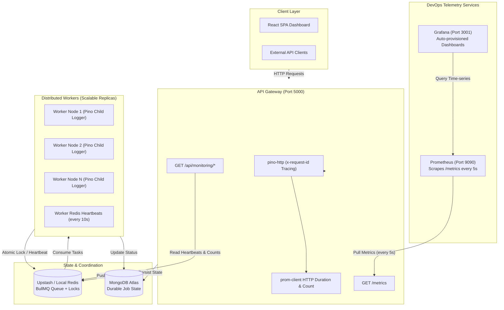

# DevOps, Observability, Logging & Testing Guide

Welcome to the comprehensive DevOps documentation for the **Distributed Job Processing Platform**. This document details the production engineering, observability stack, structured logging, request tracing, automated test suite, and operational runbooks implemented across the platform.

---

## 📑 Table of Contents

1. [Architecture Overview](#1-architecture-overview)
2. [Monitoring & Observability Stack](#2-monitoring--observability-stack)
   - [Prometheus Exporter & Metrics Catalog](#prometheus-exporter--metrics-catalog)
   - [Prometheus Configuration](#prometheus-configuration)
   - [Grafana Auto-Provisioning & Visual Dashboards](#grafana-auto-provisioning--visual-dashboards)
   - [Native Application Monitoring APIs](#native-application-monitoring-apis)
3. [Logging & Request Tracing](#3-logging--request-tracing)
   - [Structured Logging with Pino](#structured-logging-with-pino)
   - [Environment-Aware Log Formatting](#environment-aware-log-formatting)
   - [Security & PII Data Redaction](#security--pii-data-redaction)
   - [Distributed Request Tracing (Correlation IDs)](#distributed-request-tracing-correlation-ids)
   - [Worker Contextual Logging](#worker-contextual-logging)
4. [Testing Strategy & Quality Assurance](#4-testing-strategy--quality-assurance)
   - [Test Philosophy & Framework](#test-philosophy--framework)
   - [Test Execution & Status (100 Tests)](#test-execution--status-100-tests)
   - [Unit Testing Suite](#unit-testing-suite)
   - [Integration Testing Suite](#integration-testing-suite)
5. [Containerization & Orchestration](#5-containerization--orchestration)
   - [Docker Compose Multi-Container Topology](#docker-compose-multi-container-topology)
   - [Horizontal Worker Scaling](#horizontal-worker-scaling)
   - [Cloud Production Deployment (Vercel + Render + Upstash + Atlas)](#cloud-production-deployment)
6. [Operational Runbook & Troubleshooting](#6-operational-runbook--troubleshooting)

---

## 1. Architecture Overview

The platform uses a production-ready telemetry and reliability pipeline to observe system health, catch transient bottlenecks, trace errors end-to-end, and validate every layer through automated tests.



---

## 2. Monitoring & Observability Stack

The platform features a **Pull-Based Metrics Architecture** built on Prometheus and Grafana, alongside high-performance in-app monitoring endpoints for real-time dashboard telemetry.

### Prometheus Exporter & Metrics Catalog

The backend integrates [`prom-client`](https://github.com/siimon/prom-client) in [`backend/src/utils/metrics.js`](file:///d:/Backend/Backend%20Projects/Distributed%20Job%20Processing%20Platform/backend/src/utils/metrics.js), instrumented across the API server and worker layer.

#### 1. System & Runtime Metrics
- **Prefix**: `job_platform_`
- **Collector**: `collectDefaultMetrics({ register, prefix: "job_platform_" })`
- **Exported Telemetry**:
  - `job_platform_process_cpu_user_seconds_total` & `job_platform_process_cpu_system_seconds_total`
  - `job_platform_nodejs_heap_size_used_bytes`, `job_platform_nodejs_heap_size_total_bytes`
  - `job_platform_process_resident_memory_bytes` (RSS)
  - `job_platform_nodejs_eventloop_lag_seconds`
  - `job_platform_nodejs_active_handles_total`

#### 2. HTTP Request Metrics (RED Method)
Captured via Express middleware on every incoming HTTP call:
| Metric Name | Type | Labels | Description |
|---|---|---|---|
| `http_request_duration_seconds` | Histogram | `method`, `route`, `status_code` | Latency distribution of API requests. Buckets: `[0.05, 0.1, 0.25, 0.5, 1, 2.5, 5]`s. |
| `http_request_total` | Counter | `method`, `route`, `status_code` | Cumulative count of incoming API calls. |

#### 3. Queue & Cluster State Metrics
Dynamic gauges refreshed on every scrape cycle through `updateDynamicGauges()`:
| Metric Name | Type | Labels | Description |
|---|---|---|---|
| `bullmq_queue_jobs_count` | Gauge | `queue`, `state` | Real-time job counts partitioned by state: `waiting`, `active`, `delayed`, `failed`, `completed`. |
| `job_platform_active_workers_count` | Gauge | *(none)* | Current number of live worker instances broadcasting heartbeats. |
| `job_execution_duration_seconds` | Histogram | `job_type`, `status` | Worker execution duration distribution. Buckets: `[0.1, 0.5, 1, 2, 5, 10, 15]`s. |
| `jobs_processed_total` | Counter | `job_type`, `status` | Total count of processed jobs (`completed`, `failed`, `dead`, `skipped`). |

```javascript
// Excerpt from backend/src/utils/metrics.js
const updateDynamicGauges = async () => {
  const [waiting, active, delayed, failed, completed] = await Promise.all([
    jobQueue.getWaitingCount(),
    jobQueue.getActiveCount(),
    jobQueue.getDelayedCount(),
    jobQueue.getFailedCount(),
    jobQueue.getCompletedCount(),
  ]);

  queueJobCount.set({ queue: jobQueue.name, state: "waiting" }, waiting);
  queueJobCount.set({ queue: jobQueue.name, state: "active" }, active);
  queueJobCount.set({ queue: jobQueue.name, state: "delayed" }, delayed);
  queueJobCount.set({ queue: jobQueue.name, state: "failed" }, failed);
  queueJobCount.set({ queue: jobQueue.name, state: "completed" }, completed);

  const workers = await getActiveWorker();
  activeWorkersCount.set(Array.isArray(workers) ? workers.length : 0);
};
```

---

### Prometheus Configuration

Prometheus is configured in [`monitoring/prometheus/prometheus.yml`](file:///d:/Backend/Backend%20Projects/Distributed%20Job%20Processing%20Platform/monitoring/prometheus/prometheus.yml) with a 5-second scrape interval:

```yaml
global:
  scrape_interval: 5s
  evaluation_interval: 5s

scrape_configs:
  - job_name: "job-platform-api"
    metrics_path: "/metrics"
    static_configs:
      - targets: ["api:5000"]
        labels:
          service: "backend-api"
          environment: "production"
```

- Accessible locally at: `http://localhost:9090`
- Scrapes the Express API container at `http://api:5000/metrics`

---

### Grafana Auto-Provisioning & Visual Dashboards

Grafana starts with **Zero Manual Setup required**. Both datasources and dashboards are provisioned via code:

1. **Datasource Provisioning** ([`monitoring/grafana/provisioning/datasources/datasource.yml`](file:///d:/Backend/Backend%20Projects/Distributed%20Job%20Processing%20Platform/monitoring/grafana/provisioning/datasources/datasource.yml)):
   - Connects to `http://prometheus:9090` as the default Prometheus datasource.
2. **Dashboard Provider** ([`monitoring/grafana/provisioning/dashboards/dashboards.yml`](file:///d:/Backend/Backend%20Projects/Distributed%20Job%20Processing%20Platform/monitoring/grafana/provisioning/dashboards/dashboards.yml)):
   - Watches `/var/lib/grafana/dashboards` and reloads automatically every 10 seconds.
3. **Pre-configured Dashboard** ([`monitoring/grafana/dashboards/job_platform_dashboard.json`](file:///d:/Backend/Backend%20Projects/Distributed%20Job%20Processing%20Platform/monitoring/grafana/dashboards/job_platform_dashboard.json)):
   - Title: **Distributed Job Processing Platform Dashboard**
   - Access URL: `http://localhost:3001` (Default credentials: `admin` / `admin`)

#### Dashboard Layout & Panels:
```text
┌──────────────────────────────────────────────────────────────────────────────────┐
│ Row 1: System & Queue Status Overview                                            │
├─────────────────────┬─────────────────────┬───────────────────┬──────────────────┤
│ Active Worker Nodes │ Waiting Backlog     │ Active Processing │ Failed in Queue  │
│ [Stat - Threshold]  │ [Stat - Alert Area] │ [Stat - Live]     │ [Stat - Danger]  │
├─────────────────────┴─────────────────────┴───────────────────┴──────────────────┤
│ Row 2: BullMQ Queue & Processing Throughput                                      │
├───────────────────────────────────────────┬──────────────────────────────────────┤
│ Queue Status Breakdown (Time-series)      │ Throughput Rate (Jobs/sec by status) │
│ - waiting, active, delayed, failed        │ - sum(rate(jobs_processed_total[1m]))│
├───────────────────────────────────────────┴──────────────────────────────────────┤
│ Row 3: Execution Latencies & API Health                                          │
├───────────────────────────────────────────┬──────────────────────────────────────┤
│ Job Execution Latencies (P95 vs P50)      │ HTTP Request Rate by Status Code     │
│ - histogram_quantile(0.95 / 0.50, ...)    │ - sum(rate(http_request_total[1m]))  │
├───────────────────────────────────────────┴──────────────────────────────────────┤
│ Row 4: Node.js Process & Memory Health                                           │
├──────────────────────────────────────────────────────────────────────────────────┤
│ Process Memory Footprint (Heap Used vs Heap Total vs RSS Memory)                 │
└──────────────────────────────────────────────────────────────────────────────────┘
```

---

### Native Application Monitoring APIs

For the built-in React operations dashboard and headless status queries, dedicated authenticated endpoints are available under `/api/monitoring`:

- `GET /api/monitoring/overview`: Aggregated cluster summary including total jobs by status, queue backlog, and active workers.
- `GET /api/monitoring/queue`: Direct BullMQ counts (`waiting`, `active`, `delayed`, `failed`, `completed`).
- `GET /api/monitoring/workers`: Live worker heartbeats discovered via non-blocking Redis `SCAN worker:heartbeat:*`.
- `GET /api/monitoring/jobs`: Historical job statistics and processing performance.
- `GET /health`: Lightweight unauthenticated liveness probe returning `{ status: "OK", timestamp: "..." }`.

---

## 3. Logging & Request Tracing

### Structured Logging with Pino

The platform replaces legacy console logging and heavy logging libraries with [**Pino**](https://getpino.io/) ([`backend/src/utils/logger.js`](file:///d:/Backend/Backend%20Projects/Distributed%20Job%20Processing%20Platform/backend/src/utils/logger.js)), an ultra-fast, non-blocking JSON logger designed for cloud-native applications.

- **Near-Zero Overhead**: Pino logs asynchronously with minimum CPU and memory footprint, preventing event loop blocking during high-volume job spikes.
- **Base Fields**: Automatically injects `{ service: "job-processing-platform", env: "production" }` and ISO 8601 timestamps.

### Environment-Aware Log Formatting

1. **Development (`NODE_ENV=development`)**:
   - Uses `pino-pretty` to render human-readable, color-coded terminal output:
   ```text
   [2026-10-27 23:33:44.236] INFO: POST /api/auth/refresh 200
       service: "job-processing-platform"
       env: "development"
       req: { "id": "075db101-f447-4ded-b972-29fffd5c2a22", "method": "POST", "url": "/api/auth/refresh" }
       responseTime: 4
   ```
2. **Production (`NODE_ENV=production`)**:
   - Produces single-line JSON optimized for log forwarders (e.g., Datadog, Grafana Loki, AWS CloudWatch, Logstash):
   ```json
   {"level":30,"time":"2026-10-27T18:03:44.236Z","service":"job-processing-platform","env":"production","req":{"id":"075db101-f447-4ded-b972-29fffd5c2a22","method":"POST","url":"/api/auth/refresh"},"res":{"statusCode":200},"responseTime":4,"msg":"POST /api/auth/refresh 200"}
   ```

### Security & PII Data Redaction

To prevent sensitive credentials and tokens from leaking into logs or monitoring disks, Pino automatically strips confidential fields using strict path rules:

```javascript
// Excerpt from backend/src/utils/logger.js
redact: {
  paths: [
    "req.headers.authorization",
    "req.headers.cookie",
    "password",
    "token",
    "brevoApiKey",
  ],
  remove: true,
}
```

Any log containing `password`, auth headers, or API tokens replaces or strips the value before writing to stdout.

---

### Distributed Request Tracing (Correlation IDs)

The Express HTTP pipeline uses `pino-http` ([`backend/src/middleware/httpLogger.js`](file:///d:/Backend/Backend%20Projects/Distributed%20Job%20Processing%20Platform/backend/src/middleware/httpLogger.js)) to provide full trace correlation:

- **Request ID Generation**: Inspects the incoming `x-request-id` header (from API gateways, Cloudflare, or Vercel). If absent, generates an RFC-compliant UUID using `crypto.randomUUID()`.
- **Level Mapping**:
  - `HTTP >= 500` or uncaught exceptions $\rightarrow$ Logged as `error`
  - `HTTP >= 400` (e.g. 401, 403, 404, 429) $\rightarrow$ Logged as `warn`
  - `HTTP 2xx / 3xx` $\rightarrow$ Logged as `info`
- **Response Time Logging**: Calculates exact millisecond response times on every request termination.

---

### Worker Contextual Logging

Every background job is executed within a scoped child logger containing worker context ([`backend/src/worker/jobWorker.js`](file:///d:/Backend/Backend%20Projects/Distributed%20Job%20Processing%20Platform/backend/src/worker/jobWorker.js)):

```javascript
const jobLog = logger.child({ workerId, jobId, type });
jobLog.info("Starting processing for job");
```

When diagnosing failed jobs or tracking execution flow across horizontally scaled replicas, filtering by `jobId` or `workerId` instantly yields all lifecycle events for that task.

---

## 4. Testing Strategy & Quality Assurance

### Test Philosophy & Framework

Testing is built on [**Vitest**](https://vitest.dev/) ([`backend/vitest.config.mjs`](file:///d:/Backend/Backend%20Projects/Distributed%20Job%20Processing%20Platform/backend/vitest.config.mjs)) and [**Supertest**](https://github.com/ladjs/supertest). 

- **Speed**: Vitest executes tests using native Node.js worker threads with near-instant module resolution.
- **Isolation**: Each test suite runs in an isolated environment with automatic mock clearing (`clearMocks: true`).
- **Deterministic**: Tests do not require live cloud dependencies; Redis operations and database interactions use robust mocks and isolated in-memory patterns.

### Test Execution & Status (100 Tests)

The test suite contains **17 test files** and **100 tests**, maintaining a **100% pass rate**:

```bash
# Run the complete test suite once
npm --prefix backend test

# Run tests in interactive watch mode
npm --prefix backend run test:watch
```

**Current Execution Summary**:
```text
 Test Files  17 passed (17)
      Tests  100 passed (100)
   Duration  ~5s
```

---

### Unit Testing Suite

Located under [`backend/tests/unit`](file:///d:/Backend/Backend%20Projects/Distributed%20Job%20Processing%20Platform/backend/tests/unit):

| Directory | Suite File | Tests | Key Scenarios Covered |
|---|---|---|---|
| `middleware/` | `auth.test.js` | 6 | Valid JWT in header, valid JWT in cookie, missing token 401, expired token 401, invalid signature 403. |
| `middleware/` | `rateLimiter.test.js` | 3 | Allows requests below limit, sets `X-RateLimit-*` headers, returns 429 when sliding-window quota is exhausted. |
| `middleware/` | `idempotency.test.js` | 5 | Skips when header missing, caches response by key, returns cached response on replay, blocks concurrent duplicate calls. |
| `middleware/` | `backpressure.test.js` | 3 | Allows requests when queue depth < threshold, returns 503 Service Unavailable when queue is overloaded. |
| `middleware/` | `validateRequest.test.js` | 6 | Zod schema validation on body, query params, path params, returns 400 with structured validation errors. |
| `services/` | `jobService.test.js` | 9 | Job creation, BullMQ enqueueing, priority mapping, job status transitions (`PENDING` $\rightarrow$ `CANCELLED`), pagination and status filtering. |
| `services/` | `dlqService.test.js` | 5 | Fetch dead jobs, replay dead jobs back into BullMQ, reset retry attempts on re-enqueue. |
| `services/` | `monitoringService.test.js` | 3 | Aggregated metric summaries, queue counts, worker heartbeat parsing. |
| `processors/` | `email.processor.test.js` | 8 | Brevo API successful dispatch, simulated transient failure retry backoff, permanent validation error $\rightarrow$ unrecoverable error, simulation mode latency, edge case payloads. |
| `utils/` | `jwt.test.js` | 4 | Access token generation/verification, refresh token generation/verification, custom claims extraction. |
| `utils/` | `lock.test.js` | 6 | Atomic Redis `SET NX EX` lock acquisition, lock collision handling, TTL expiry protection, safe lock release by token. |
| `utils/` | `timeout.test.js` | 4 | Task completion within deadline, timeout rejection, AbortSignal triggering, edge timeout boundary. |

---

### Integration Testing Suite

Located under [`backend/tests/integration`](file:///d:/Backend/Backend%20Projects/Distributed%20Job%20Processing%20Platform/backend/tests/integration) using Supertest against the Express app:

| Suite File | Tests | Endpoints & Flows Tested |
|---|---|---|
| `auth.routes.test.js` | 12 | Registration (`POST /api/auth/register`), duplicate email rejection, login (`POST /api/auth/login`), secure cookie issuance, token refresh rotation (`POST /api/auth/refresh`), logout cookie clearing, `/api/auth/me`. |
| `job.routes.test.js` | 11 | Submission (`POST /api/jobs`), idempotency handling, paginated listing (`GET /api/jobs`), single job query (`GET /api/jobs/:id`), job cancellation (`DELETE /api/jobs/:id`). |
| `dlq.routes.test.js` | 7 | Retrieve dead jobs (`GET /api/jobs/dead`), replay dead job (`POST /api/jobs/:id/retry`), concurrent lock conflict 400, 404 for non-existent jobs, 400 for invalid job state retry. |
| `monitoring.routes.test.js` | 5 | Unauthenticated guard 401, queue stats (`/api/monitoring/queue`), job aggregation (`/api/monitoring/jobs`), active workers (`/api/monitoring/workers`), full cluster overview (`/api/monitoring/overview`). |
| `health.routes.test.js` | 3 | Unauthenticated liveness probe (`GET /health`), 404 for unknown route with standard error format, Helmet security headers verification. |

---

## 5. Containerization & Orchestration

### Docker Compose Multi-Container Topology

The entire platform, including monitoring services, can be launched locally with a single command via [`backend/docker-compose.yml`](file:///d:/Backend/Backend%20Projects/Distributed%20Job%20Processing%20Platform/backend/docker-compose.yml):

```yaml
services:
  # Service 3: API Gateway
  api:
    build:
      context: .
      dockerfile: Dockerfile
    container_name: job_platform_api
    ports: ["5000:5000"]
    env_file: [.env]
    environment:
      - PORT=5000
      - NODE_ENV=production
    networks: [job-network]

  # Service 4: Background Workers (Scalable)
  worker:
    build:
      context: .
      dockerfile: Dockerfile
    command: node src/worker.js
    deploy:
      replicas: 3
    env_file: [.env]
    environment:
      - NODE_ENV=production
    networks: [job-network]

  # Service 5: Prometheus Server
  prometheus:
    image: prom/prometheus:latest
    container_name: job_platform_prometheus
    restart: unless-stopped
    volumes:
      - ../monitoring/prometheus/prometheus.yml:/etc/prometheus/prometheus.yml:ro
      - prometheus_data:/prometheus
    ports: ["9090:9090"]
    networks: [job-network]
    depends_on: [api]

  # Service 6: Grafana (Auto-Provisioned)
  grafana:
    image: grafana/grafana:latest
    container_name: job_platform_grafana
    restart: unless-stopped
    ports: ["3001:3000"]
    environment:
      - GF_SECURITY_ADMIN_USER=admin
      - GF_SECURITY_ADMIN_PASSWORD=admin
      - GF_USERS_ALLOW_SIGN_UP=false
    volumes:
      - ../monitoring/grafana/provisioning:/etc/grafana/provisioning:ro
      - ../monitoring/grafana/dashboards:/var/lib/grafana/dashboards:ro
      - grafana_data:/var/lib/grafana
    networks: [job-network]
    depends_on: [prometheus]
```

#### Launching the Stack:
```bash
# Start all containers in detached mode
npm run docker:up

# View real-time cluster logs
docker compose -f backend/docker-compose.yml logs -f

# Teardown the stack and keep volumes
npm run docker:down
```

---

### Horizontal Worker Scaling

Workers are completely stateless. To handle heavy batch workloads, scale worker replicas dynamically without downtime:

```bash
# Scale worker pool from 3 to 10 instances
docker compose -f backend/docker-compose.yml up -d --scale worker=10
```

Each worker automatically registers a distinct heartbeat key in Redis (`worker:heartbeat:worker_<hostname>`), visible in Grafana and the React dashboard within 10 seconds.

---

### Cloud Production Deployment

| Layer | Platform | Runtime Details & Architecture Strategy |
|---|---|---|
| **Frontend** | **Vercel** | Single Page Application (SPA), CDN-cached, redirects to backend URL via `VITE_API_URL`. |
| **API Gateway** | **Render (Web Service)** | Docker container. Port 5000. Auto-deploys from `backend/Dockerfile`. |
| **Worker Cluster** | **Render (Web Service)** | Docker container. Port 10000. **Cost Optimization**: Render background workers require paid plans ($7/mo); we host workers on Render's free Web Service tier with an embedded lightweight HTTP health check endpoint on port 10000. |
| **Message Broker** | **Upstash Redis** | Serverless Redis with native TLS encryption. Handles BullMQ job queues, atomic distributed locks, and worker heartbeats. |
| **Durable Database** | **MongoDB Atlas** | M0 cluster. Durable source of truth for user accounts, job states, retry history, and dead letter records. |

---

## 6. Operational Runbook & Troubleshooting

### Scenario 1: High Queue Backlog Detected
1. **Symptom**: Grafana panel *"Waiting Backlog (Queue)"* turns amber or red (>50 jobs).
2. **Diagnosis**:
   - Check *"Active Worker Nodes"*. If count is 0 or low, workers may be down or disconnected from Redis.
   - Check *"Job Execution Duration (P95)"*. If duration spiked to >15s, tasks may be hitting timeouts.
3. **Remediation**:
   - Scale worker replicas: `docker compose -f backend/docker-compose.yml up -d --scale worker=6`.
   - Check worker logs for unhandled external API rate limits (e.g., Brevo email API).

### Scenario 2: Jobs Accumulating in Dead Letter Queue (`DEAD`)
1. **Symptom**: `Failed Jobs in Queue` increases or jobs appear in `/api/jobs/dead`.
2. **Diagnosis**:
   - Filter logs by `status: "DEAD"` in terminal or log viewer.
   - Inspect `db.jobs.find({ status: "DEAD" })` to read the exact error message and stack trace.
3. **Remediation**:
   - If caused by bad client input (e.g. invalid email format), no replay is needed.
   - If caused by downstream service outage that has recovered, trigger 1-Click Replay via the Dashboard or API:
     ```http
     POST /api/jobs/:id/retry
     ```

### Scenario 3: Investigating a Specific Job Failure
1. Find the `jobId` from the dashboard or error alert.
2. In production logs, search for structured JSON entries matching:
   ```json
   {"jobId":"<target_job_id>"}
   ```
3. The child logger reveals:
   - Worker node that picked up the task (`workerId`).
   - Lock acquisition status.
   - Execution payload.
   - Attempt count and exact exception stack trace.

### Scenario 4: Verifying Scrape Target Health
1. Open Prometheus target dashboard: `http://localhost:9090/targets`.
2. Verify that `job-platform-api` displays **State: UP**.
3. If State is DOWN, ensure the API container is running and reachable on `job-network:5000`. Test manually with:
   ```bash
   curl http://localhost:5000/metrics
   ```
