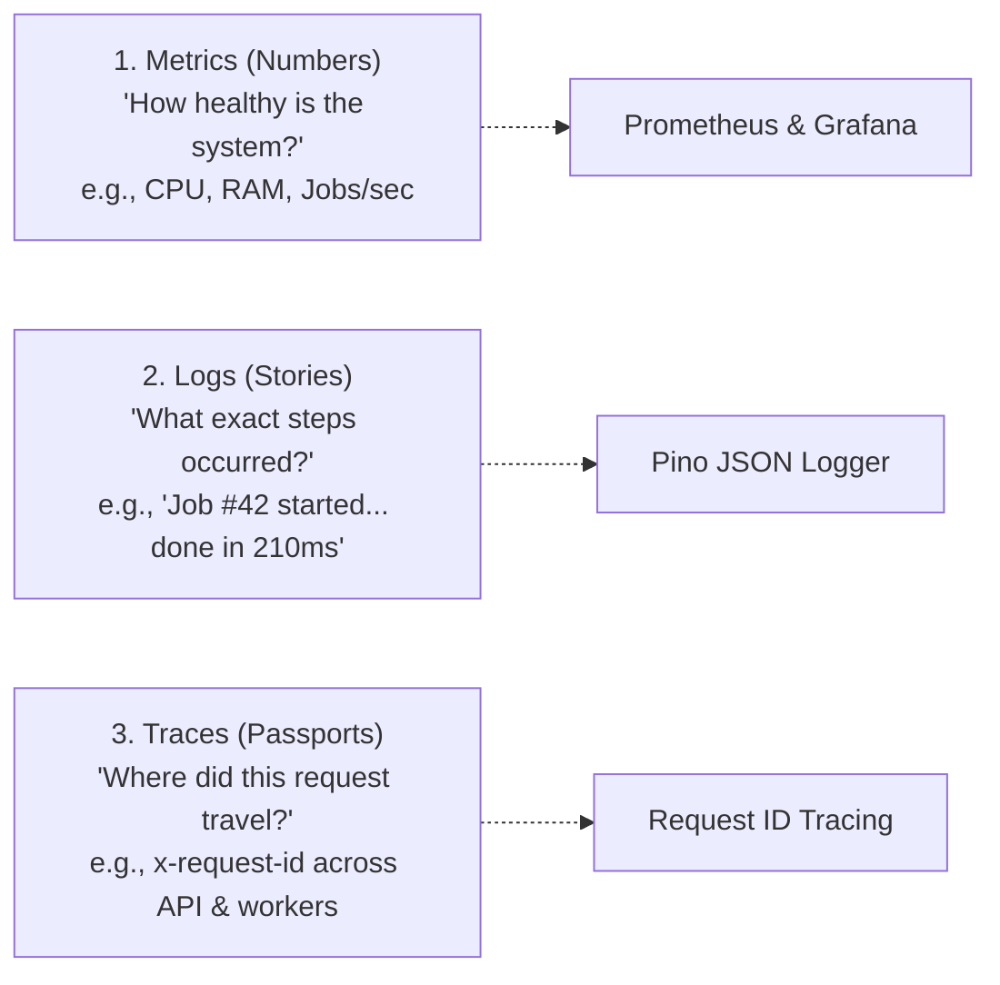
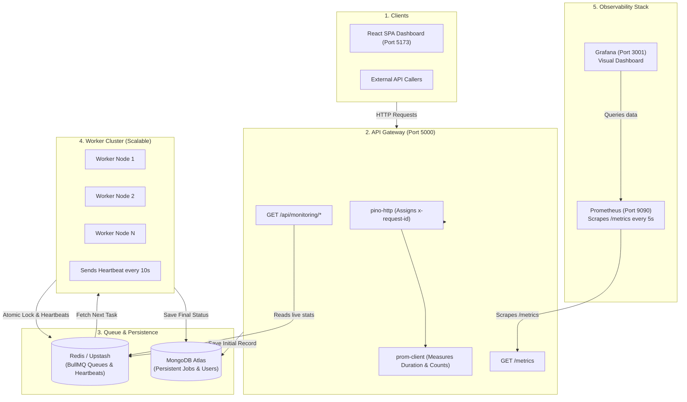
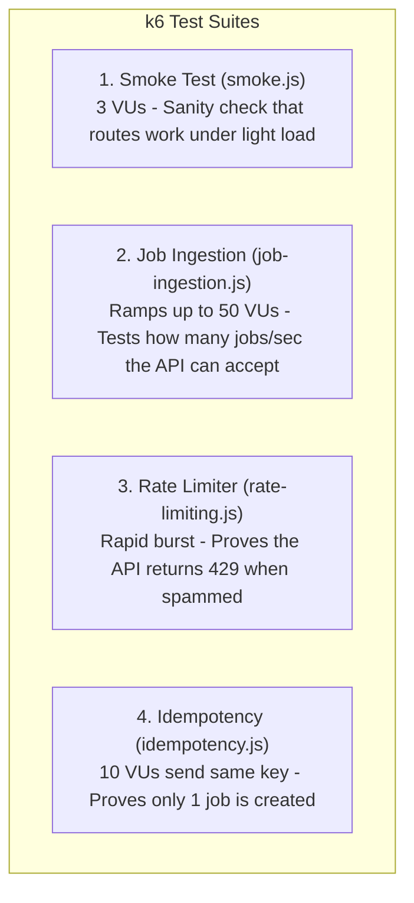

# DevOps, Observability, Logging & Testing Guide

> **Welcome!** This guide is designed to make the operational side of the **Distributed Job Processing Platform** simple, crystal-clear, and practical. Whether you are setting up monitoring for the first time, troubleshooting a failed background task, running tests, or deploying to the cloud, you will find both easy-to-understand explanations and exact technical instructions here.

---

## 📑 Table of Contents

1. [DevOps in Simple Terms: The Big Picture](#1-devops-in-simple-terms-the-big-picture)
2. [Architecture & System Flow](#2-architecture--system-flow)
3. [Monitoring & Observability (Prometheus & Grafana)](#3-monitoring--observability-prometheus--grafana)
4. [Structured Logging & Tracing (Pino)](#4-structured-logging--tracing-pino)
5. [Automated Testing Suite (Vitest)](#5-automated-testing-suite-vitest)
6. [Load & Performance Testing (k6)](#6-load--performance-testing-k6)
7. [Containerization & Scaling (Docker & Cloud)](#7-containerization--scaling-docker--cloud)
8. [Operational Runbook (Troubleshooting Recipes)](#8-operational-runbook-troubleshooting-recipes)
9. [DevOps Quick Command Reference](#9-devops-quick-command-reference)

---

## 1. DevOps in Simple Terms: The Big Picture

### What is this platform doing?
When a user clicks "Send 10,000 Emails" or "Process Video" on a website, the server cannot make the user wait for 10 minutes. 
Instead:
1. The **API Gateway** accepts the request instantly, assigns it a tracking ID, and responds with `"Job Accepted (202)"`.
2. The job is queued into **Redis**.
3. Background **Workers** pull jobs from Redis one-by-one, process them (e.g., sending emails via Brevo), and save the results into **MongoDB**.

### Why do we need "DevOps & Observability"?
In a distributed system, background workers run invisibly behind the scenes. If a worker crashes, gets stuck in an infinite loop, runs out of memory, or starts dropping emails, users won't see an immediate error page — jobs will just quietly fail or pile up.

DevOps and Observability give us **X-ray vision** into the running system using **The Three Pillars of Observability**:



### Jargon Buster (Quick Glossary)

| Term | What It Means in Plain English |
|---|---|
| **Observability** | Being able to understand what's happening *inside* the system just by looking at its outputs (metrics, logs, traces). |
| **Scrape** | Prometheus pulling numbers from our API's `/metrics` endpoint on a timer (every 5 seconds). |
| **RED Method** | A standard way to measure web services: **R**ate (requests/sec), **E**rrors (failures/sec), **D**uration (latency in seconds). |
| **Percentiles (P50 & P95)** | **P50 (Median)** is the response time experienced by the average user. **P95** means 95% of users had equal or faster times; it highlights the worst-case slowdowns. |
| **Backpressure** | Temporarily rejecting or slowing new requests (returning HTTP `503`) when the queue is already full, protecting the system from collapsing. |
| **Idempotency** | Ensuring that submitting the exact same request twice (e.g., double-clicking a submit button) only performs the action once. |
| **DLQ (Dead Letter Queue)** | A special quarantine status (`DEAD`) for jobs that failed all retry attempts so an engineer can inspect and replay them manually. |
| **RSS (Resident Set Size)** | The actual physical RAM memory occupied by a Node.js process. |

---

## 2. Architecture & System Flow

### System Architecture Diagram



### The Life of a Job (Step-by-Step)
1. **Creation**: A client sends `POST /api/jobs` with payload `{ type: "EMAIL", payload: { to: "user@example.com" } }`.
2. **Gateway**:
   - `pino-http` attaches a unique `x-request-id`.
   - `validateRequest` checks the payload using Zod.
   - `idempotency` checks if this job was already submitted recently.
   - Saves initial job state `PENDING` in MongoDB and enqueues it into BullMQ in Redis.
   - Responds to client with `202 Accepted` and the `jobId`.
3. **Execution**:
   - An available **Worker** picks up the job from Redis.
   - Worker acquires a distributed lock in Redis so no other worker touches it.
   - Status changes to `PROCESSING`.
   - The worker executes the task (e.g. calls Brevo Email API).
4. **Completion or Failure**:
   - **Success**: Status changes to `COMPLETED` in MongoDB.
   - **Failure**: If an error occurs, BullMQ retries with exponential backoff (e.g. wait 2s, then 4s, then 8s). If all retries fail, it is marked `DEAD` (Dead Letter Queue).
5. **Observability**:
   - Prometheus collects the execution time and outcome counter from `/metrics`.
   - Grafana updates charts showing throughput, latency, and queue size in real time.

---

## 3. Monitoring & Observability (Prometheus & Grafana)

Think of **Prometheus** like a doctor who visits the API every 5 seconds to take its vitals (pulse, temperature, blood pressure).  
Think of **Grafana** like the wall-mounted screen displaying those vitals as graphs and warning lights.

```
+------------------+         PULL (every 5s)         +--------------------+         QUERY         +------------------+
|  Node.js API     | <============================== |     Prometheus     | <==================== |     Grafana      |
|  (:5000/metrics) |  "How many jobs did you run?"   |   (Database: 9090) |   "Draw the graphs"   | (Dashboard: 3001)|
+------------------+                                 +--------------------+                       +------------------+
```

### 1. Prometheus Metrics

The API uses [`prom-client`](https://github.com/siimon/prom-client) in [`backend/src/utils/metrics.js`](file:///d:/Backend/Backend%20Projects/Distributed%20Job%20Processing%20Platform/backend/src/utils/metrics.js) to count events and measure timings.

#### A. System & Node.js Health
Tells us if the Node.js server itself is healthy or about to crash:
- `job_platform_process_cpu_user_seconds_total`: How much CPU the server is consuming.
- `job_platform_nodejs_heap_size_used_bytes`: Memory actively used by JavaScript objects.
- `job_platform_process_resident_memory_bytes` (RSS): Total physical memory taken by the Node.js process.
- `job_platform_nodejs_eventloop_lag_seconds`: How busy the JavaScript event loop is. A high lag (> 100ms) means the server is frozen processing heavy calculations.

#### B. HTTP API Metrics (The RED Method)
Tells us how the public API Gateway is handling traffic:
- `http_request_duration_seconds` *(Histogram)*: How fast API endpoints respond, bucketed across `[0.05s, 0.1s, 0.25s, 0.5s, 1s, 2.5s, 5s]`.
- `http_request_total` *(Counter)*: Total number of requests received, tagged with `method` (GET/POST), `route` (e.g. `/api/jobs`), and `status_code` (200, 400, 500).

#### C. Queue & Background Worker Metrics
Tells us if workers are keeping up or falling behind:
- `bullmq_queue_jobs_count` *(Gauge)*: How many jobs are currently in each state: `waiting` (backlog), `active` (processing), `delayed`, `failed`, `completed`.
- `job_platform_active_workers_count` *(Gauge)*: How many worker servers are currently online and sending heartbeats.
- `job_execution_duration_seconds` *(Histogram)*: Time taken to process jobs, bucketed across `[0.1s, 0.5s, 1s, 2s, 5s, 10s, 15s]`.
- `jobs_processed_total` *(Counter)*: Total jobs processed, labeled by `job_type` (e.g., `EMAIL`) and `status` (`COMPLETED` or `FAILED`).

---

### 2. Prometheus Configuration

Located at [`monitoring/prometheus/prometheus.yml`](file:///d:/Backend/Backend%20Projects/Distributed%20Job%20Processing%20Platform/monitoring/prometheus/prometheus.yml).

```yaml
global:
  scrape_interval: 5s       # Fetch metrics from our app every 5 seconds
  evaluation_interval: 5s

scrape_configs:
  - job_name: "job-platform-api"
    metrics_path: "/metrics"
    static_configs:
      - targets: ["api:5000"] # In Docker, talks directly to the API container
        labels:
          service: "backend-api"
          environment: "production"
```

> **Open Prometheus UI**: Visit `http://localhost:9090` to run raw PromQL queries (e.g. `rate(http_request_total[1m])`).

---

### 3. Grafana Dashboards (Zero Manual Setup)

Grafana is configured using **Infrastructure as Code (IaC)**. You do **not** need to click around in the UI to add datasources or import dashboard JSONs. When Docker starts, Grafana configures itself automatically:

| File | What It Does |
|---|---|
| [`provisioning/datasources/datasource.yml`](file:///d:/Backend/Backend%20Projects/Distributed%20Job%20Processing%20Platform/monitoring/grafana/provisioning/datasources/datasource.yml) | Tells Grafana: *"Connect to Prometheus at `http://prometheus:9090` as default datasource"*. |
| [`provisioning/dashboards/dashboards.yml`](file:///d:/Backend/Backend%20Projects/Distributed%20Job%20Processing%20Platform/monitoring/grafana/provisioning/dashboards/dashboards.yml) | Tells Grafana: *"Scan `/var/lib/grafana/dashboards` every 10 seconds and load any dashboard files found"*. |
| [`dashboards/job_platform_dashboard.json`](file:///d:/Backend/Backend%20Projects/Distributed%20Job%20Processing%20Platform/monitoring/grafana/dashboards/job_platform_dashboard.json) | The pre-built dashboard containing 4 rows of live graphs. |

- **Access Grafana**: `http://localhost:3001`
- **Default Login**: Username: `admin` | Password: `admin`

**What the Dashboard Shows:**
1. **Row 1 — Status Overview**: Big stat panels showing active worker nodes, waiting queue backlog, active jobs, and failed jobs.
2. **Row 2 — Queue & Throughput**: Time-series graph of queue state over time + job throughput rate (jobs processed per second).
3. **Row 3 — Latency & API Health**: Job execution time (comparing 95th percentile vs 50th percentile) + HTTP request rate split by status code (2xx vs 4xx vs 5xx).
4. **Row 4 — Process Health**: Node.js memory footprint (Heap Used, Heap Total, Resident Memory).

---

### 4. Built-In API Monitoring Endpoints

Besides Prometheus, the API provides direct JSON endpoints for the frontend dashboard:

| Endpoint | Authentication | What It Returns |
|---|---|---|
| `GET /health` | None (Public) | Quick ping for load balancers: `{ "status": "OK", "timestamp": "..." }` |
| `GET /metrics` | None (Public / Prometheus) | Raw Prometheus text-formatted metrics |
| `GET /api/monitoring/overview` | JWT Bearer | Summary of queue counts, total jobs, and worker counts |
| `GET /api/monitoring/queue` | JWT Bearer | Live counts for BullMQ (`waiting`, `active`, `failed`, `completed`) |
| `GET /api/monitoring/workers` | JWT Bearer | List of online workers, their hostnames, and last heartbeat timestamps |
| `GET /api/monitoring/jobs` | JWT Bearer | Aggregate historical job stats (completed vs failed vs processing) |

---

## 4. Structured Logging & Tracing (Pino)

### Why not just use `console.log()`?
1. **Performance**: `console.log` in Node.js is **synchronous**. If your app logs thousands of lines per second, Node.js blocks its single thread, causing major slowdowns.
2. **Searchability**: `console.log("User 123 created job 456")` produces plain text that is hard for machines to filter or query.
3. **The Solution**: We use [**Pino**](https://getpino.io/) ([`backend/src/utils/logger.js`](file:///d:/Backend/Backend%20Projects/Distributed%20Job%20Processing%20Platform/backend/src/utils/logger.js)), an ultra-fast JSON logger that formats logs as structured data.

### Development vs Production Logs

**In Development** (Human-friendly and colorized with `pino-pretty`):
```text
[2026-10-28 22:30:12.140] INFO: POST /api/jobs 202
    service: "job-processing-platform"
    req: { "id": "f81d4fae-7dec-11d0-a765-00a0c91e6bf6", "method": "POST", "url": "/api/jobs" }
    responseTime: 18ms
```

**In Production** (One line of JSON per event — ready for cloud aggregators like Datadog, AWS CloudWatch, or Loki):
```json
{"level":30,"time":"2026-10-28T17:00:12.140Z","service":"job-processing-platform","req":{"id":"f81d4fae-...","method":"POST","url":"/api/jobs"},"res":{"statusCode":202},"responseTime":18,"msg":"POST /api/jobs 202"}
```

---

### Security: Automatic Secret & PII Redaction
If an engineer logs an entire HTTP request, secret tokens or passwords might accidentally be written to log files.  
In [`backend/src/utils/logger.js`](file:///d:/Backend/Backend%20Projects/Distributed%20Job%20Processing%20Platform/backend/src/utils/logger.js), Pino is configured to automatically strip sensitive fields before writing anything:

```javascript
redact: {
  paths: [
    "req.headers.authorization", // Strips JWT tokens from headers
    "req.headers.cookie",        // Strips session cookies
    "password",                  // Strips user passwords
    "token",                     // Strips any field named 'token'
    "brevoApiKey"                // Strips third-party email API keys
  ],
  remove: true,
}
```

---

### Request Tracing (`x-request-id`) & Scoped Worker Logs

**The Problem**: If 50 users submit jobs simultaneously, how do you find which logs belong to which user?

**The Solution**:
1. When an HTTP request arrives, [`backend/src/middleware/httpLogger.js`](file:///d:/Backend/Backend%20Projects/Distributed%20Job%20Processing%20Platform/backend/src/middleware/httpLogger.js) checks for an `x-request-id` header (or generates a fresh UUID).
2. All logs produced during that request carry that same ID.
3. When the worker starts processing a job, it creates a **Child Logger** scoped to that specific job ([`backend/src/worker/jobWorker.js`](file:///d:/Backend/Backend%20Projects/Distributed%20Job%20Processing%20Platform/backend/src/worker/jobWorker.js)):

```javascript
const jobLog = logger.child({ workerId, jobId, type });
jobLog.info("Starting processing for job");
```

Now, if job `6612a8...` fails, you can search for `jobId: "6612a8..."` and see its entire lifecycle from API submission to worker failure.

---

## 5. Automated Testing Suite (Vitest)

Tests ensure that when you change code or refactor a service, you don't accidentally break authentication, rate limiting, or queue processing.

- **Test Runner**: [Vitest](https://vitest.dev/) (blazing-fast native ESM test runner) + [Supertest](https://github.com/ladjs/supertest) (for HTTP assertions).
- **Config**: [`backend/vitest.config.mjs`](file:///d:/Backend/Backend%20Projects/Distributed%20Job%20Processing%20Platform/backend/vitest.config.mjs).
- **Zero Cloud Dependencies**: All Redis and MongoDB calls are mocked. Tests run 100% locally in isolated worker threads in ~5 seconds.

### Quick Commands

```bash
# Run all 100 tests once
npm --prefix backend test

# Run tests in watch mode (re-runs automatically on file save)
npm --prefix backend run test:watch
```

### Complete Test Breakdown (100 Tests)

```text
 ✓ tests/unit/middleware/auth.test.js (6 tests)
 ✓ tests/unit/middleware/rateLimiter.test.js (3 tests)
 ✓ tests/unit/middleware/idempotency.test.js (5 tests)
 ✓ tests/unit/middleware/backpressure.test.js (3 tests)
 ✓ tests/unit/middleware/validateRequest.test.js (6 tests)
 ✓ tests/unit/services/jobService.test.js (9 tests)
 ✓ tests/unit/services/dlqService.test.js (5 tests)
 ✓ tests/unit/services/monitoringService.test.js (3 tests)
 ✓ tests/unit/processors/email.processor.test.js (8 tests)
 ✓ tests/unit/utils/jwt.test.js (4 tests)
 ✓ tests/unit/utils/lock.test.js (6 tests)
 ✓ tests/unit/utils/timeout.test.js (4 tests)
 ✓ tests/integration/auth.routes.test.js (12 tests)
 ✓ tests/integration/job.routes.test.js (11 tests)
 ✓ tests/integration/dlq.routes.test.js (7 tests)
 ✓ tests/integration/monitoring.routes.test.js (5 tests)
 ✓ tests/integration/health.routes.test.js (3 tests)

 Test Files  17 passed (17)
      Tests  100 passed (100)
```

#### Unit Tests (`backend/tests/unit/`)
Tests individual functions and middleware in complete isolation:

| Category | File | What It Tests |
|---|---|---|
| **Auth Middleware** | `auth.test.js` | Verifies JWT verification from headers/cookies, blocks expired tokens with 401, blocks invalid signatures with 403. |
| **Rate Limiter** | `rateLimiter.test.js` | Checks rate limit headers (`X-RateLimit-*`) and blocks traffic with `429 Too Many Requests` when limit exceeded. |
| **Idempotency** | `idempotency.test.js` | Tests caching of duplicate requests using the `Idempotency-Key` header so actions don't run twice. |
| **Backpressure** | `backpressure.test.js` | Verifies that when the Redis queue exceeds capacity, the API returns `503 Service Unavailable`. |
| **Validation** | `validateRequest.test.js` | Tests Zod schema validation on request body/params; ensures `400 Bad Request` with helpful error messages. |
| **Job Service** | `jobService.test.js` | Tests job creation, priority mapping, cancellation, pagination, and status filters. |
| **DLQ Service** | `dlqService.test.js` | Tests fetching dead jobs, re-enqueuing them back into BullMQ, and resetting attempt counters. |
| **Monitoring** | `monitoringService.test.js` | Tests metric aggregation, queue counting, and worker heartbeat parsing. |
| **Email Processor** | `email.processor.test.js` | Tests Brevo email sending, exponential backoff retries on network error, and dead-lettering on fatal errors. |
| **Distributed Lock** | `lock.test.js` | Tests Redis atomic locks (`SET NX EX`), race-condition handling, TTL expiry, and safe token releases. |
| **Timeout Guard** | `timeout.test.js` | Tests worker task execution deadlines and graceful abort handling using `AbortSignal`. |
| **JWT Utilities** | `jwt.test.js` | Tests access/refresh token generation, cryptographic signing, and expiration decoding. |

#### Integration Tests (`backend/tests/integration/`)
Spins up the Express application and sends real simulated HTTP requests:

| File | What It Tests |
|---|---|
| `auth.routes.test.js` | Full auth cycle: user registration, duplicate email rejection, login, cookie issuance, token rotation, and logout. |
| `job.routes.test.js` | Full job cycle: `POST /api/jobs` returns 202, schema validation returns 400, fetching by ID, pagination, and cancelling pending jobs. |
| `dlq.routes.test.js` | Querying dead jobs, retrying a dead job via `POST /api/jobs/:id/retry`, and preventing retry of active jobs. |
| `monitoring.routes.test.js` | Security check ensuring monitoring endpoints require authentication, returning queue & worker stats. |
| `health.routes.test.js` | Unauthenticated `GET /health` returns 200 OK, Helmet security headers are present, and 404s on non-existent routes. |

---

## 6. Load & Performance Testing (k6)

### What is Load Testing?
Load testing means bombarding your server with simulated traffic to see:
- *Can our API handle 100 requests per second without crashing?*
- *Does our rate limiter actually stop spammers?*
- *Do duplicate requests get safely handled by idempotency keys?*

We use [**k6**](https://k6.io/), an open-source performance testing tool. All test scripts are in [`backend/tests/load/`](file:///d:/Backend/Backend%20Projects/Distributed%20Job%20Processing%20Platform/backend/tests/load).

> [!NOTE]
> k6 runs against a **live running backend server**. Make sure your backend API is started (`npm run dev:backend`) before running these tests.

### The 4 Load Test Scenarios



| Script | Purpose | Virtual Users (VUs) | Success Criteria |
|---|---|---|---|
| [`smoke.js`](file:///d:/Backend/Backend%20Projects/Distributed%20Job%20Processing%20Platform/backend/tests/load/smoke.js) | Basic sanity check of `/health`, `/metrics`, and `/api/jobs` | 3 VUs | 95% of requests respond in under 150ms; 0% errors. |
| [`job-ingestion.js`](file:///d:/Backend/Backend%20Projects/Distributed%20Job%20Processing%20Platform/backend/tests/load/job-ingestion.js) | Stress test for job submission throughput | Ramps up to 50 VUs | Measures jobs accepted per second; 95% respond in under 400ms. |
| [`rate-limiting.js`](file:///d:/Backend/Backend%20Projects/Distributed%20Job%20Processing%20Platform/backend/tests/load/rate-limiting.js) | Burst test to verify DDoS protection | High frequency burst | Successfully triggers `429 Too Many Requests` + `Retry-After` header. |
| [`idempotency.js`](file:///d:/Backend/Backend%20Projects/Distributed%20Job%20Processing%20Platform/backend/tests/load/idempotency.js) | Race condition test | 10 concurrent VUs with same key | 1st request returns `202 Accepted`; remaining 9 return `200 Cached Result`. |

### How to Run Load Tests

```bash
# 1. Start the backend API in one terminal
npm run dev:backend

# 2. In another terminal, run any of the k6 tests:
npm run test:load:smoke          # Baseline smoke test
npm run test:load:jobs           # High-throughput ingestion benchmark
npm run test:load:rate-limit     # Rate limiter burst test
npm run test:load:idempotency    # Race condition test

# Run with custom users or duration
k6 run --vus 20 --duration 30s backend/tests/load/job-ingestion.js

# Target a remote staging or production server
k6 run -e BASE_URL=https://your-api.onrender.com backend/tests/load/smoke.js
```

> **Pro Tip**: Open Grafana (`http://localhost:3001`) while running `npm run test:load:jobs`. You will see the queue depth spike and the throughput graph rise in real time!

---

## 7. Containerization & Scaling (Docker & Cloud)

### Run Everything with Docker Compose

Rather than manually launching Redis, MongoDB, Prometheus, Grafana, API, and Workers in 6 separate terminal windows, [`backend/docker-compose.yml`](file:///d:/Backend/Backend%20Projects/Distributed%20Job%20Processing%20Platform/backend/docker-compose.yml) starts the entire ecosystem with one command:

```bash
# Build and start all containers in the background
npm run docker:up

# View live streaming logs from all services
docker compose -f backend/docker-compose.yml logs -f

# Shut down and stop all containers
npm run docker:down
```

### Containers in the Stack

| Container Name | Internal Port | Host Port | What It Runs |
|---|---|---|---|
| `job_platform_api` | 5000 | `5000` | Express API Gateway (accepts jobs, serves `/metrics`) |
| `job_platform_worker_1..3` | 10000 | — | BullMQ Workers (3 worker replicas running by default) |
| `job_platform_prometheus` | 9090 | `9090` | Prometheus time-series database (scrapes metrics) |
| `job_platform_grafana` | 3000 | `3001` | Grafana visual dashboard (pre-loaded with charts) |

---

### Horizontal Scaling (Adding More Workers)

Because workers are **stateless** (they don't store files locally, they just pull from Redis and write to Mongo), you can scale up workers to 5, 10, or 20 instances instantly with zero downtime:

```bash
# Scale to 5 worker instances
docker compose -f backend/docker-compose.yml up -d --scale worker=5
```

Each worker automatically registers its own heartbeat in Redis (`worker:heartbeat:worker_<hostname>`). Within 10 seconds, Grafana's *"Active Worker Nodes"* panel will increase to `5`.

---

### Cloud Production Deployment Map

When moving to the cloud, each part of the platform is hosted on specialized infrastructure:

| Component | Platform | Free Tier / Cost | Notes |
|---|---|---|---|
| **Frontend** | Vercel | Free | Global CDN. Environment variable: `VITE_API_URL` pointing to Render API. |
| **API Gateway** | Render (Web Service) | Free | Built via `backend/Dockerfile`, exposed on port 5000. |
| **Workers** | Render (Web Service) | Free ($0) | CMD override: `node src/worker.js`. Runs on port 10000. *(See trick below)* |
| **Queue (Redis)** | Upstash Redis | Free | Serverless Redis with TLS support (`rediss://...`). |
| **Database** | MongoDB Atlas | Free (M0) | Cloud MongoDB. Whitelist `0.0.0.0/0` in Network Access. |

> 💡 **The Free-Tier Worker Trick ($0 vs $7/mo)**:  
> Render charges \$7/month for dedicated "Background Worker" instances because they don't have open HTTP ports.  
> To keep this project **100% free**, our worker code embeds a tiny HTTP server on port `10000` that simply responds `{"status": "worker-online"}`. This allows us to deploy workers as **Render Web Services** on the free tier! You can use a free pinging service like [cron-job.org](https://cron-job.org) to ping port 10000 every 10 minutes to prevent Render from putting the free instance to sleep.

---

## 8. Operational Runbook (Troubleshooting Recipes)

When an alert triggers or something goes wrong, follow these battle-tested recipes:

---

### 🔴 Problem 1: High Queue Backlog (Waiting Jobs > 50)
*Symptom*: Grafana's *"Waiting Backlog"* panel turns amber/red, and users report their jobs are taking too long to start.

1. **Check Worker Count**: Look at the *"Active Worker Nodes"* panel in Grafana.
   - If it shows `0`, your workers are dead or disconnected from Redis.
   - Run `docker compose -f backend/docker-compose.yml ps` to check if workers are running.
2. **Check P95 Execution Latency**:
   - If jobs are taking 30+ seconds, the third-party API (e.g. Brevo) may be slow or timing out.
3. **Resolution**:
   - **Step A**: Add more workers to process the backlog faster:
     ```bash
     docker compose -f backend/docker-compose.yml up -d --scale worker=6
     ```
   - **Step B**: Check worker logs for rate limits:
     ```bash
     docker compose -f backend/docker-compose.yml logs worker | grep -i "rate limit"
     ```

---

### 🔴 Problem 2: Jobs Accumulating in Dead Letter Queue (`DEAD`)
*Symptom*: Grafana shows a spike in *"Failed in Queue"*, or `GET /api/monitoring/overview` shows dead jobs.

1. **Find the Dead Jobs**: Visit your frontend dashboard or query the API:
   ```bash
   curl -H "Authorization: Bearer <TOKEN>" http://localhost:5000/api/jobs/dead
   ```
2. **Inspect the Error**:
   - Look at `error.message` and `error.stack` inside MongoDB:
     ```javascript
     db.jobs.find({ status: "DEAD" }, { jobId: 1, error: 1 })
     ```
3. **Resolution**:
   - **Case A (Invalid Input)**: If the client passed an invalid email address (e.g., `user@@notanemail`), the error was intentional. No action needed.
   - **Case B (Temporary Outage)**: If Brevo or Redis was temporarily down and has recovered, replay the dead job using:
     ```http
     POST /api/jobs/:id/retry
     ```
     The job resets its attempt counter to 0 and re-enters the active queue.

---

### 🔴 Problem 3: Debugging a Specific Job Failure
*Symptom*: A user contacts support with a specific `jobId` saying their job failed.

1. **Search Logs by Job ID**: Because Pino uses structured logging, search for the `jobId` in your terminal or log viewer:
   ```bash
   docker compose -f backend/docker-compose.yml logs | grep "6612a8f9c1..."
   ```
2. **Read the Execution Trail**:
   - Which worker picked up the job (`workerId: "worker-node-2"`)?
   - Did the worker acquire the distributed lock?
   - What were the retry attempts and exact error stack?

---

### 🔴 Problem 4: Grafana Shows "No Data" / Prometheus Target Down
*Symptom*: Grafana panels are blank or show red exclamation marks.

1. **Check Prometheus Targets**:
   - Open `http://localhost:9090/targets` in your browser.
   - Look at `job-platform-api`. If State is `DOWN`, Prometheus cannot reach the API.
2. **Verify API `/metrics`**:
   - Test if the API is responding to metrics requests:
     ```bash
     curl http://localhost:5000/metrics
     ```
3. **Resolution**:
   - Ensure the API container is running:
     ```bash
     docker compose -f backend/docker-compose.yml restart api
     ```
   - Check that `monitoring/prometheus/prometheus.yml` points to `api:5000` (internal Docker hostname) and not `localhost:5000`.

---

## 9. DevOps Quick Command Reference

Bookmark this table for everyday commands across testing, monitoring, and operations:

| Category | Command | Description |
|---|---|---|
| **Automated Tests** | `npm --prefix backend test` | Run all 100 unit & integration tests once |
| **Automated Tests** | `npm --prefix backend run test:watch` | Run tests in interactive watch mode |
| **Load Testing** | `npm run test:load:smoke` | Run light sanity smoke test (3 VUs) |
| **Load Testing** | `npm run test:load:jobs` | Run job ingestion throughput benchmark |
| **Load Testing** | `npm run test:load:rate-limit` | Test rate limiter DDoS protection |
| **Load Testing** | `npm run test:load:idempotency` | Test duplicate prevention with same key |
| **Docker** | `npm run docker:up` | Build & launch API, Workers, Prometheus, Grafana |
| **Docker** | `npm run docker:down` | Stop and remove all Docker containers |
| **Docker** | `docker compose -f backend/docker-compose.yml logs -f` | Stream logs from all running containers |
| **Docker** | `docker compose -f backend/docker-compose.yml up -d --scale worker=5` | Instantly scale worker pool to 5 replicas |
| **Monitoring URLs** | `http://localhost:3001` | **Grafana Dashboard** (`admin` / `admin`) |
| **Monitoring URLs** | `http://localhost:9090` | **Prometheus Query UI** |
| **Monitoring URLs** | `http://localhost:5000/metrics` | Raw Prometheus scrape endpoint |
| **Monitoring URLs** | `http://localhost:5000/health` | Public API liveness check |
