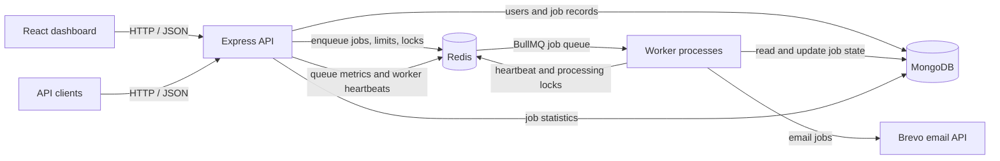

# Distributed Job Processing Platform

A full-stack background job processing application. It accepts authenticated job submissions over an HTTP API, persists job records in MongoDB, places work on a Redis-backed BullMQ queue, and processes jobs in independently scalable Node.js workers. A React dashboard provides job management and operational metrics.

## Project overview

The repository contains three application parts:

- **API (`backend/src/server.js`)** — Express REST API for authentication, job submission and management, dead-letter job handling, and monitoring.
- **Workers (`backend/src/worker.js`)** — BullMQ consumers that execute queued jobs. Workers run separately from the API and can be scaled horizontally.
- **Dashboard (`frontend/`)** — React single-page application built with Vite. It uses the API for login, job operations, and dashboard data.

MongoDB is the durable source of truth for users and job state. Redis supports BullMQ queue storage and also coordinates rate limits, idempotency keys, worker heartbeats, and distributed locks.

## System architecture



### Job lifecycle

1. A user authenticates and submits a job to `POST /api/jobs`. The current supported job type is `email`.
2. The API validates the request, applies rate limiting and queue backpressure checks, and stores a `PENDING` job document in MongoDB.
3. The API adds the job to the BullMQ `job-queue` in Redis. If enqueueing fails, the record is marked `FAILED` and the API responds with an error.
4. A worker claims the BullMQ item, acquires a Redis lock, and atomically moves an eligible MongoDB record to `PROCESSING` while incrementing its attempt count.
5. The registered processor handles the job. Successful jobs become `COMPLETED`; failures are retried with exponential backoff (up to the configured attempts) and eventually marked `DEAD` when retries are exhausted or the error is permanent.
6. Users can inspect failed/dead jobs and request a requeue. The API also runs an orphan-job sweeper that checks old pending records and re-enqueues records missing from BullMQ.

The worker sends a Redis heartbeat every 10 seconds; the heartbeat expires after 30 seconds. The dashboard reads these records to show active worker health. Queue counts come from BullMQ, while per-user job statistics come from MongoDB.

## Features

- User registration and login with bcrypt password hashing, JWT access tokens, and HTTP-only access/refresh cookies.
- Authenticated job submission with type, payload, priority, and maximum retry attempts.
- Idempotency key handling to prevent duplicate submissions, with Redis coordination and a MongoDB uniqueness constraint per user.
- Redis-backed sliding-window rate limits and configurable queue backpressure.
- BullMQ retries with exponential backoff, job progress reporting, execution timeout, and worker concurrency configuration.
- Job listing, detail lookup, pending-job cancellation, dead-letter listing, and manual retry.
- Monitoring endpoints and dashboard for queue counts, job status totals, and worker heartbeats.
- Optional email delivery through Brevo; without a Brevo API key, email processing runs in simulation mode.
- Docker Compose services for MongoDB, Redis, the API, and three worker replicas.

## Technology stack

| Area | Technologies |
| --- | --- |
| Frontend | React, Vite, Lucide React |
| API and workers | Node.js, Express 5, BullMQ 6, Mongoose |
| Queue and coordination | Redis, ioredis |
| Persistence | MongoDB |
| Validation and security | Zod, bcryptjs, JSON Web Tokens, Helmet, CORS |
| Local deployment | Docker Compose |

## Repository layout

```text
.
├── backend/
│   ├── src/
│   │   ├── config/         # Environment, MongoDB, Redis, and job constants
│   │   ├── controllers/    # HTTP request handlers
│   │   ├── cron/           # Orphan pending-job recovery
│   │   ├── middleware/     # Auth, validation, limits, idempotency, errors
│   │   ├── models/         # Mongoose User and Job models
│   │   ├── processors/     # Job type dispatch and email processor
│   │   ├── queues/         # BullMQ queue producer
│   │   ├── routes/         # API route definitions
│   │   ├── services/       # Job, DLQ, and monitoring operations
│   │   ├── utils/          # JWT, locks, timeouts, worker heartbeat
│   │   ├── server.js       # API process entry point
│   │   └── worker.js       # Worker process entry point
│   ├── .env.example
│   ├── Dockerfile
│   └── docker-compose.yml
└── frontend/
    ├── src/                # React dashboard and API client
    ├── .env.example
    └── vite.config.js
```

## Prerequisites

- Node.js 20 or later and npm
- MongoDB and Redis, either installed locally or started with Docker Compose
- (Optional) a Brevo API key and verified sender for live email delivery

## Local development

1. Install backend and frontend dependencies:

   ```bash
   npm --prefix backend install
   npm --prefix frontend install
   ```

2. Create `backend/.env` from `backend/.env.example`. Set the MongoDB and Redis connection details. Replace the development token secrets before exposing the service beyond your machine. Configure `BREVO_API_KEY` and sender details only if you want live email delivery.

3. Start MongoDB and Redis, then launch the API and dashboard in separate terminals from the repository root:

   ```bash
   npm run dev:backend
   npm run dev:frontend
   ```

   Start one or more workers in additional terminals:

   ```bash
   npm run worker
   ```

   By default, the API listens on port `3000`, the dashboard on `5173`, and the Vite development proxy forwards `/api` requests to `http://localhost:3000`. Set `VITE_API_URL` in `frontend/.env` to override the frontend API URL. The worker exposes a lightweight health response on `PORT` (default `10000`); set a distinct port if running multiple workers directly on one host.

4. Register an account in the dashboard and submit an email job. The dashboard supports email templates and job priority/retry options. With no Brevo key configured, the worker simulates delivery.

## Docker Compose

The Compose file is `backend/docker-compose.yml`. Create `backend/.env` first, then run from the repository root:

```bash
npm run docker:up
```

This starts MongoDB, Redis, the API, and three worker replicas. The API is exposed on port `5000`; the Compose configuration sets the MongoDB/Redis hostnames for container networking and sets `NODE_ENV=production`. Stop the stack with:

```bash
npm run docker:down
```

MongoDB and Redis data use named Docker volumes (`mongo_data` and `redis_data`) and persist across container restarts.

## Configuration

Backend settings are loaded from `backend/.env` (see [`backend/.env.example`](backend/.env.example)). Important variables:

| Variable | Purpose | Default |
| --- | --- | --- |
| `PORT` | API port; worker health port when running worker process | `3000` |
| `NODE_ENV` | Runtime mode | `development` |
| `MONGO_URI` | MongoDB connection string | `mongodb://localhost:27017/job_platform` |
| `REDIS_HOST`, `REDIS_PORT`, `REDIS_PASSWORD` | Redis connection settings | `localhost`, `6379`, empty password |
| `CLIENT_URL` | Browser origin allowed by API CORS | `http://localhost:5173` |
| `WORKER_CONCURRENCY` | Jobs handled concurrently by each worker | `5` |
| `WORKER_ID` | Optional worker ID prefix | `worker_1` |
| `ACCESS_TOKEN_SECRET`, `REFRESH_TOKEN_SECRET` | JWT signing secrets | Development placeholders; replace them |
| `ACCESS_TOKEN_EXPIRES_IN`, `REFRESH_TOKEN_EXPIRES_IN` | Token lifetime settings | `15m`, `7d` |
| `MAX_QUEUE_CAPACITY` | Waiting-job threshold used for producer backpressure | `1000` |
| `RATE_LIMIT_MAX_REQUESTS`, `RATE_LIMIT_WINDOW_SECONDS` | Redis-backed rate limit defaults | `10`, `60` |
| `BREVO_API_KEY` | Enables live email delivery | Empty (simulation mode) |
| `BREVO_SENDER_EMAIL`, `BREVO_SENDER_NAME` | Email sender identity | `noreply@example.com`, `Distributed Job Platform` |

The Docker Compose API maps its internal port to host port `5000` and overrides the container's `PORT`. The dashboard API URL is configured separately with `VITE_API_URL`.

## HTTP API

The API base path is `/api`; the health check is `/health`. Routes requiring authentication accept the access token from the HTTP-only cookie or an `Authorization: Bearer <token>` header. Job and monitoring data are scoped to the authenticated user where applicable.

| Method | Path | Description |
| --- | --- | --- |
| `POST` | `/api/auth/register` | Register with `name`, `email`, and `password` |
| `POST` | `/api/auth/login` | Login; issues access and refresh cookies |
| `POST` | `/api/auth/refresh` | Rotate tokens using the refresh cookie |
| `POST` | `/api/auth/logout` | Clear session cookies and stored refresh token |
| `GET` | `/api/auth/me` | Get the authenticated user |
| `POST` | `/api/jobs` | Submit a job; optional `Idempotency-Key` header |
| `GET` | `/api/jobs?page=1&limit=10&status=PENDING` | List the user's jobs, optionally filtered by status |
| `GET` | `/api/jobs/:id` | Get a job by its `jobId` |
| `DELETE` | `/api/jobs/:id` | Cancel a job while it is `PENDING` |
| `GET` | `/api/jobs/dead?page=1&limit=10` | List the user's dead-letter jobs |
| `POST` | `/api/jobs/:id/retry` | Requeue a failed or dead job |
| `GET` | `/api/monitoring/queue` | BullMQ queue counts |
| `GET` | `/api/monitoring/jobs` | Current user's job totals by status |
| `GET` | `/api/monitoring/workers` | Active worker heartbeat data |
| `GET` | `/api/monitoring/overview` | Combined queue, job, and worker metrics |
| `GET` | `/health` | API liveness response |

Example job request:

```http
POST /api/jobs
Content-Type: application/json
Idempotency-Key: 89ad1092-9cac-4de0-9b11-023806a4e012

{
  "type": "email",
  "payload": {
    "to": "person@example.com",
    "subject": "Your report is ready",
    "text": "The report is attached."
  },
  "priority": 2,
  "maxAttempts": 3
}
```

Job creation returns `202 Accepted` with the new job's ID and initial status. The only registered processor type is currently `email`; processors are dispatched through `backend/src/processors/index.js`.

## Job states

| Status | Meaning |
| --- | --- |
| `PENDING` | Persisted and waiting to be processed |
| `PROCESSING` | Claimed by a worker |
| `RETRYING` | A retryable attempt failed and another attempt may run |
| `COMPLETED` | Processor finished successfully |
| `FAILED` | Enqueue failed or job failed before being classified as dead |
| `DEAD` | Retries exhausted or processor returned an unrecoverable error |
| `CANCELLED` | Cancelled by the owner while pending |

BullMQ jobs use a default of three attempts with exponential backoff starting at two seconds. Job submissions can override the attempt count. Worker processor execution has a 15-second timeout. Invalid email recipient/subject data is treated as unrecoverable; recipient `fail@example.com` triggers a simulated transient failure for exercising retry behavior.

## Current scope and extension points

The queue and processor registry are structured to support additional job types, but the application currently implements only email jobs. Add a processor and register its type in `backend/src/processors/index.js`, then update the job type constants and validation as needed. Authentication currently supports regular users and an `admin` role field, while the exposed job and dashboard operations are user-scoped.

